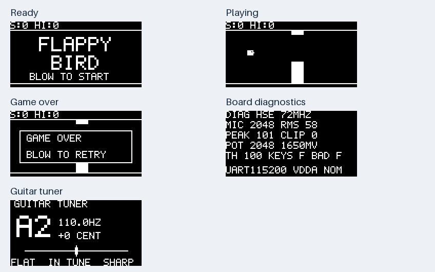

# 声控 Flappy Bird / Hello MCU 固件 v1.0.0

为当前自制STM32F103C8T6主板开发的教学正式版固件，包含声控游戏、OLED自检、吉他调音、串口命令、ADC+DMA双通道及PWM音效。用户已确认v0.1.1正常游戏版可运行；v1.0.0默认启用得分/碰撞蜂鸣器，新音效的实际响声及声学反馈仍需这次烧录确认。

**零基础先看[项目完整入门课](docs/COURSE_ZERO_TO_EMBEDDED.md)。制作新板前必读[硬件实物与勘误](docs/HARDWARE_AS_BUILT_AND_ERRATA.md)：归档PCB含已知按键接法错误，不可直接当作已修订生产文件。**

**第一次接触本项目：先看[新手设计说明](docs/BEGINNER_GUIDE.md)，再看 [main.c](src/main.c)。想调手感或灵敏度，优先修改 [app_config.h](include/app_config.h)。**

代码以可读性为先：游戏位置和速度直接用小数，音量使用普通平方根公式，调音使用可对应数学公式的浮点表达，字体直接用`#`与`.`画点阵。没有RTOS、自定义内存池、复杂框架或手写定点优化。采样、串口的边界保护仍保留，并在中文注释中解释原因。

## 当前直接烧游戏版

2026-09-23：用户已确认等待次数24的正常GPIO游戏版测试正常。推荐 **`firmware/flappy_f103.hex`**；`firmware/flappy_f103_compat.hex`保留192等待作为更慢的兼容备选。两者默认启用得分/碰撞4kHz、60ms短音，从鸣叫开始屏蔽声音触发300ms，并要求重新安静后才能再次吹气触发；串口`mute on`关闭游戏音效、`mute off`开启。具体操作见[游戏版上手步骤](docs/GAME_QUICKSTART.md)。

游戏版优先使用外部8MHz晶振/PLL 72MHz，外部晶振超时则回退到内部时钟并通过界面/串口报告。`firmware/board_selftest.hex`保留供排查使用：默认自检界面、内部时钟PLL 64MHz；无需把逐项自检全部做完才能烧游戏版。

独立固件发布包中选择`firmware/flappy_f103.hex`；完整教学tar.gz解压后选择`01_firmware/flappy_f103.hex`。Windows也可从`\\wsl.localhost\Ubuntu-24.04\home\cunyu\outputs\Flappy_Bird_Firmware_v1.0.0_20260923\firmware`访问本次交付文件。

1. 主板 USB 供电，ST-LINK 接 GND、SWDIO、SWCLK，下载器3.3V/5V供电脚留空。
2. STM32CubeProgrammer：SWD、100kHz、Normal、Software reset。
3. 打开对应 HEX，保留文件自带地址；开启烧录校验后下载。若使用 BIN，起始地址必须是 `0x08000000`。
4. 选择烧录后运行。如果没有该选项，成功校验后断开软件连接，再重新给主板 USB 上电。
5. 不需要修改读保护或其他选项字节。烧录操作会覆盖对应程序区；本工具不自动执行烧录。

## 本批板子的按键问题

SW5 已拆除后恢复正常 SWD 连接。SW1–SW4 同样存在触点分组接错问题，未返修时会持续把 PB15–PB12 接地。固件会屏蔽从未稳定释放的按键，串口报告 `BLOCKED=F`，自检显示 `BAD F`。这代表四个键都被屏蔽，不是程序卡住。

当前可通过吹气或串口进行测试；软件无法修复电气短接。完成正常按键操作以及题目 GPIO 输入验收前，需要修正 SW1–SW4。所有按键 GPIO 保持上拉输入，绝不输出高电平去对抗短接。

## 接线

按 PCB 方形焊盘识别1脚，再核对实物丝印，不凭排线颜色判断。

### 微雪2.42英寸白色OLED（SKU25742，SSD1309，4线SPI）

| 主板 J2 脚号 | 屏模块信号 | MCU |
| --- | --- | --- |
| 1 | VCC，3.3V | 电源 |
| 2 | GND | 地 |
| 3 | DIN | PA7 |
| 4 | CLK | PA5 |
| 5 | CS | PA4 |
| 6 | DC | PB8 |
| 7 | RST | PB9 |
| 8 | 不接，备用GND | 地 |

屏幕保持出厂SPI配置。正式版沿用已实测正常的GPIO模拟mode0、每字节高位先发，PA5/PA7等接线不变。原硬件SPI约1MHz时黑屏，具体失败原因尚未证实。每轮最多发送8字节像素，额外用一个1024字节数组记住已发画面并跳过相同块，给音频和游戏任务留出处理时间。128×64页寻址及初始化命令保持不变。

### USB转串口

| USB-TTL | 主板 J4 |
| --- | --- |
| RXD | 2，PA9/TX |
| TXD | 3，PA10/RX |
| GND | 4，GND |
| VCC/5V/3V3 | 留空，由主板USB供电 |

串口信号必须是3.3V逻辑。终端设 **115200、8位、无校验、1停止位、无流控**，发送以换行结束。主板Type-C只供电，不能替代这个UART口；小型ST-LINK V2也不能当作串口。

### 电位器与麦克风

J5：1=3V3，2=电位器滑臂/PA1，3、4=GND。10kΩ电位器两端接3V3和GND，中间滑臂接2脚。麦克风通过板载模拟前端进入PA0，不应额外向其输入5V。

## 分项检查参考

这些项目用于定位问题，不是当前进入游戏的前置步骤。D2短闪、低速GPIO诊断及正常游戏版已由用户确认；正式版新增默认蜂鸣器音效待实物确认。

1. **自检固件**：D1电源灯常亮；D2状态灯正常时每秒短闪，初始化错误或ADC不更新时快闪。OLED完成初始化后显示 `DIAG HSI 64MHZ`；保守传输速度下首次清屏会稍慢。固件只有写屏接口，无法自动确认屏幕是否实际亮起。
2. **串口**：上电应收到 `HELLO MCU`、时钟和采样状态；发送 `help`、`status`。若错过上电日志，`status` 可重复查询。`BLOCKS`应不断增加，`FAULT=0`，正常负载下`LOST=0`。
3. **麦克风**：上电前约1.2秒保持安静，之后 `CAL DONE`。静态 `MIC/ADC` 通常接近中点约2048；吹气时`RMS/PEAK`应明显增加。`CLIP`是每128个音频采样中接近上下限的数量，调音时应避免明显削顶。
4. **电位器**：转动后`POT`原始值应接近0到4095变化。显示电压暂按名义3300mV换算；精度验收前测实际VDDA并执行例如 `vdda 3295`。NRST的3.15V不是ADC基准，不能拿它校准VDDA。
5. **蜂鸣器**：得分与碰撞默认短响约4kHz、60ms；不需要每次吹气都鸣叫。`beep`可手动测试，`mute on`关闭自动游戏音效但不影响声控；调音模式禁止鸣叫，包括`beep`。程序已有300ms声音触发屏蔽，实际环境中若仍有误触发，可先静音再查麦克风位置和门限。
6. **游戏**：发送 `menu`进入准备界面，再吹气，或发 `play`开始、`flap`上跳。碰撞后再次吹气可重开。游戏逻辑按50Hz更新，画面最多每40ms提交一次；实际帧率受SPI速度和变化区域大小影响，兼容版会更慢。
7. **调音**：发送 `tuner`，拨一根琴弦；显示最近标准六弦、频率和音分。`0 CENT`接近标准，负值偏低、正值偏高。有效范围65–400Hz；环境、音源谐波和内部时钟误差均会影响精度，正式调音优先确认游戏版实际使用HSE。
8. **主版本时钟**：`flappy_f103.hex`串口应显示`CLK=HSE/72000000`；若显示`HSI/64000000`，表示外部晶振未通过启动检查，应单独排查。

如黑屏，先确认终端能收到日志，再检查7根屏线、电源和SPI配置；不要同时改驱动、接线与电源。LED、屏幕或蜂鸣器的现象需要实物反馈，不能仅凭编译成功断言硬件正常。

## 串口命令

| 命令 | 行为 |
| --- | --- |
| `help` / `status` | 命令说明 / 当前数据、时钟、错误计数 |
| `menu` | 游戏准备界面 |
| `play` / `flap` | 开新局 / 上跳；准备或结束时flap也可开局 |
| `pause` / `resume` | 暂停 / 继续当前游戏 |
| `diag` / `tuner` | 自检 / 吉他调音模式 |
| `cal` | 保持安静，重新标定声音门限 |
| `threshold 150` | 手动设音量RMS门限，范围1–4095，并关闭电位器控制 |
| `pot on` / `pot off` | 启用 / 禁用电位器控制门限；默认关闭 |
| `vdda 3295` | 设置实测ADC基准电压mV，范围2000–3600 |
| `beep` | 手动短音测试，调音模式禁用 |
| `mute on` / `mute off` | 关闭 / 开启游戏音效，不影响声音控制 |
| `stream on` / `stream off` | 每秒输出状态 / 停止周期输出 |

命令不区分大小写。非法参数和超长行会被拒绝；串口丢字后整批未处理数据作废，重新发送换行再重发命令。参数与最高分首版仅存在RAM，下次上电恢复默认；不要误认为已经写入Flash。

修复按键后：SW1上跳/返回游戏、SW2暂停/继续、SW3循环游戏→自检→调音、SW4重新标定。故障按键不会阻塞主循环。声音触发需先回落50ms，并有180ms最短触发间隔，持续吹气不会无限连跳。

## 构建和验证

使用 PlatformIO Core 6.1.19 或兼容版本，在项目根目录执行：

```sh
pio run -e flappy_f103 -e flappy_f103_compat -e board_selftest
python3 tools/run_tests.py
python3 tools/run_tests.py --sanitize
python3 tools/package_release.py
```

项目固定 ststm32 20.0.0，使用官方 STM32CubeF1 HAL；依赖的确切版本记录在发布验证清单。构建需要首次下载工具链。`run_tests.py`需本机gcc，消毒器测试依赖GCC的ASan/UBSan；因当前容器限制关闭LSan，固件业务代码不使用堆分配。

源码导览：`main.c`清楚列出七个循环任务；`app.c`连接各模块并画界面；`board.c`处理硬件与中断；`core.c`处理游戏、音量和按键；`pitch.c`是选学的YIN式周期检测；`display.c`是SSD1309及可视点阵字库；`command.c`检查命令格式。每次调音计算最多2个候选周期，采样丢块就丢弃不连续音频帧，避免显示虚假频率。分步执行是为了保持其他功能响应，不是为了省内存。

显示预览来自实际C绘图函数输出的帧缓存，不是实物照片：



## 对照题目

| 题目要求 | 对应实现 | 实物待验证 |
| --- | --- | --- |
| GPIO输入/输出 | 四键消抖、PC13状态灯 | 按键返修后验证输入 |
| UART双向 | 115200命令+状态 | USB-TTL收发 |
| ADC+DMA | PA0/PA1双通道循环DMA、半/全块处理 | 音频、电位器及误差 |
| TIM+NVIC | TIM3采样触发、TIM4 1ms IRQ | 持续运行及丢块计数 |
| SPI设备 | GPIO模拟SPI、SSD1309分块刷新 | 诊断及正常游戏版已由用户确认 |
| 至少3状态 | READY/PLAY/PAUSE/OVER，另有DIAG/TUNER | 完整交互 |
| 非阻塞协同 | UART队列、每轮最多8字节像素、分步调音 | 长时间联调及实际丢块情况 |

本机测试不代表ADC已达到题目<5%的实测误差，也不代表整板硬件已定版。
