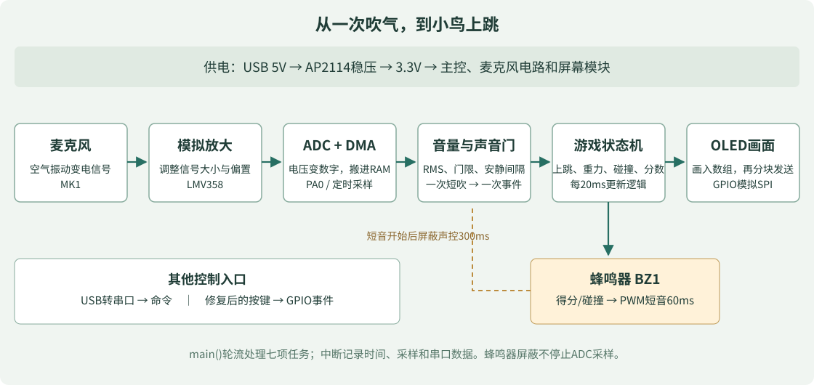

# 学习与授课入口

1. [零基础完整课程](../02_source/docs/COURSE_ZERO_TO_EMBEDDED.md)：从基础电学到10个实验，贯穿硬件、固件、制造和装配。
2. [硬件实物与勘误](../02_source/docs/HARDWARE_AS_BUILT_AND_ERRATA.md)：先确认主板版本、脚号、电源和按键问题。
3. [第一次烧录与游戏操作](../02_source/docs/GAME_QUICKSTART.md)：先取得可以观察的结果。
4. [从main读代码的设计指南](../02_source/docs/BEGINNER_GUIDE.md)：逐段理解已经在板上运行的程序。
5. [详细设计](../02_source/docs/DESIGN.md)与[验证记录](../02_source/docs/VERIFICATION.md)：学习如何记录设计依据和验证边界。
6. [真实黑屏排查过程](../02_source/docs/OLED_BLACK_SCREEN.md)：看到现象、提出假设、控制变量、留下证据。

建议老师每次课只安排一个可验证的小目标：学生先预测修改后的现象，再动手，最后解释结果。按键硬件返修应由有经验的人处理，学生可以先通过声控和串口完成软件实验。
