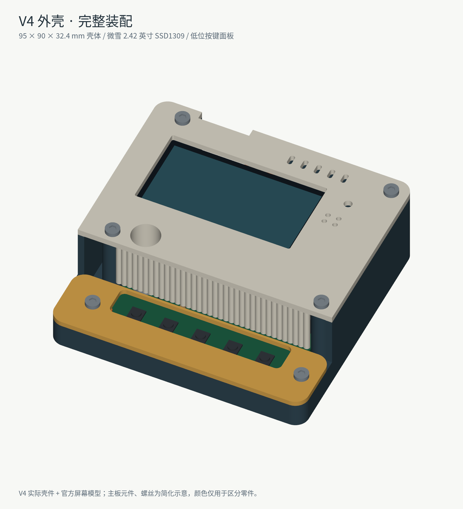
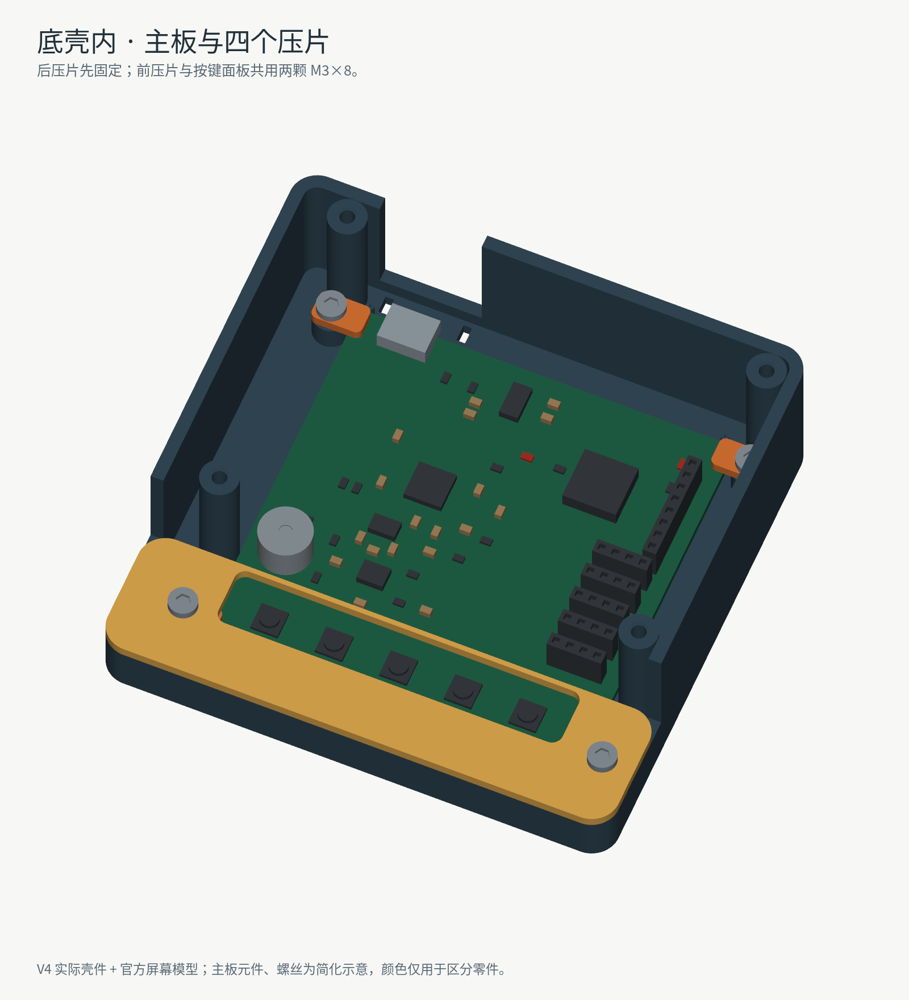

# V4 外壳装配图解

本图解使用实际 V4 壳件、微雪 SKU25742 的官方屏幕模型，以及最新主板的 52 器件位置。螺丝和主板器件外形为简化示意，线束省略以便看清固定结构；颜色仅用于区分零件。

## 先辨认零件

有五个按键的一侧为前方，USB 开槽的一侧为后方。下面的左右均按正常使用时面向屏幕的方向描述。

| 文件 | 零件 | 数量 |
|---|---|---:|
| `base.stl` | 深色底壳 | 1 |
| `main_lid.stl` | 浅色主盖，带屏幕窗口、麦克风通道及前挡板 | 1 |
| `button_deck.stl` | 金色低位按键面板 | 1 |
| `oled_tray.stl` | 橙色屏幕托架 | 1 |
| `clip_1.stl` / `clip_2.stl` | 前左 / 前右主板压片 | 各 1 |
| `clip_3.stl` / `clip_4.stl` | 后左 / 后右主板压片 | 各 1 |
| `fit_coupon.stl` | 公差试片，只用来测试孔与螺丝配合 | 1，不装入外壳 |

实际装配使用 8 个打印件。微雪屏幕必须为 2.42inch OLED Module 白屏 SKU25742、61.5×39.5mm 版本。

## 螺丝清单

| 位置 | 螺丝 | 数量 | 拧入方向 |
|---|---|---:|---|
| 主盖固定到底壳 | M3×8 | 4 | 从主盖外侧向下 |
| 按键面板与前压片 | M3×8 | 2 | 从按键面板外侧向下，穿过面板和前压片 |
| 后方两片主板压片 | M3×6 | 2 | 从上向下 |
| 屏幕四个原厂固定柱 | M2.5×5 + 0.5mm 厚绝缘平垫 | 各 4 | 从托架背面穿入，朝向屏幕 |
| 托架前后凸耳与上盖柱 | M2×6 + 0.5mm 厚小垫片 | 各 2 | 从托架背面穿入，朝向上盖 |

共 14 颗螺丝、6 片垫片。M2/M2.5 的螺丝头和垫片外径须≤5mm。图中使用简化内六角头展示位置，采购时以实际头径、长度和孔位配合为准。

塑料柱底孔按试装方案设计，不含已建模的螺纹或热熔铜螺母。先用公差试片确认孔径，必要时轻攻螺纹，手动轻拧；不可用电批硬拧。M2.5×5 穿过 2.4mm 托架和 0.5mm 垫片后，名义伸入屏幕柱 2.1mm，第一次拧入应确认不会顶到屏幕内部。

## 1. 安装主板

1. 全部断电。清理打印毛刺，检查插件焊脚是否过长；主板底面到壳内底的名义空间为 3.6mm。
2. 主板元件面朝上，USB 对准后侧 U 形开槽，五个按键朝前，放在四角支承上。
3. 放入四个压片：螺丝孔在主板外侧，压片另一端压住板角。用两颗 M3×6 先固定后方压片，轻拧到定位。
4. 将按键面板放到前方，长开口对准五个按键。用两颗 M3×8 从面板穿过前压片，拧入底壳柱。不要拧弯主板。

本设计用压片固定主板，不依赖工厂后来添加的角孔。

## 2. 将屏幕装到托架

1. 用柔软、干净的垫面保护屏幕正面，避免让玻璃或排线承受集中压力。
2. 把橙色托架对准屏幕背面四个原厂金属固定柱。屏幕背面连接器与托架浅槽对齐，托架只承托固定柱，不压元件和玻璃。
3. 在托架四角，从背面依次穿入 M2.5×5 螺丝及 0.5mm 绝缘垫片，拧入屏幕原厂柱。先全部带上螺丝，再均匀轻拧。

## 3. 将屏幕组件装到主盖

1. 把主盖外表面朝下放在软垫上，内侧螺柱朝上。
2. 屏幕显示面朝主盖窗口，托架朝壳内。检查玻璃与主盖之间仍有间隙。
3. 用两颗 M2×6 加 0.5mm 垫片，从托架前后两个凸耳穿入，拧进主盖对应的塑料柱。其余四颗 M2.5 螺丝只负责连接屏幕，不拧进主盖。

## 4. 接线、测试、合盖

J2 第 1～7 脚依次为 **3V3、GND、DIN、CLK、CS、DC、RST**，第 8 脚为备用 GND。按编号和标签接线，不能使用旧 V3 文档中的电源针序。

主板 J2 是排母。若屏幕配套线末端也是母头，用短公对公线转接，把连接处平放在屏幕下方；不要竖直堆叠长转接头。线束从屏幕连接器沿左侧向下，在屏下转向右侧 J2，并预留抬起上盖时的余量。

接线及裸板测试完成后断电，缓慢放下主盖，确认没有夹线、压住连接器或碰到背面元件，再用四颗 M3×8 从主盖外侧拧入底壳柱。之后检查 USB 插拔、五个按键操作和麦克风通道。

## 查看完整 3D 模型

- `V4_complete_assembly.glb`：完整彩色总装，包含主板、屏幕及螺丝的参考模型；可在支持 GLB 的查看器中旋转观察。GLB 按米保存，展示软件不应按毫米解释它。
- `V4_complete_assembly.step`：同一完整装配的 STEP，单位 mm，可在支持 STEP 的 CAD 中查看。
- `V4_housing_assembled.step`：仅含 8 个打印壳件，已放到装配位置；不含公差试片。

这些是装配展示文件。打印仍使用原 V4 包的各个分件 STL，不要将整个装配模型当成一个零件打印。此前 V4 打印文件未作修改；首套仍需实物试装，重点确认插头、弯线、螺丝和打印公差。
